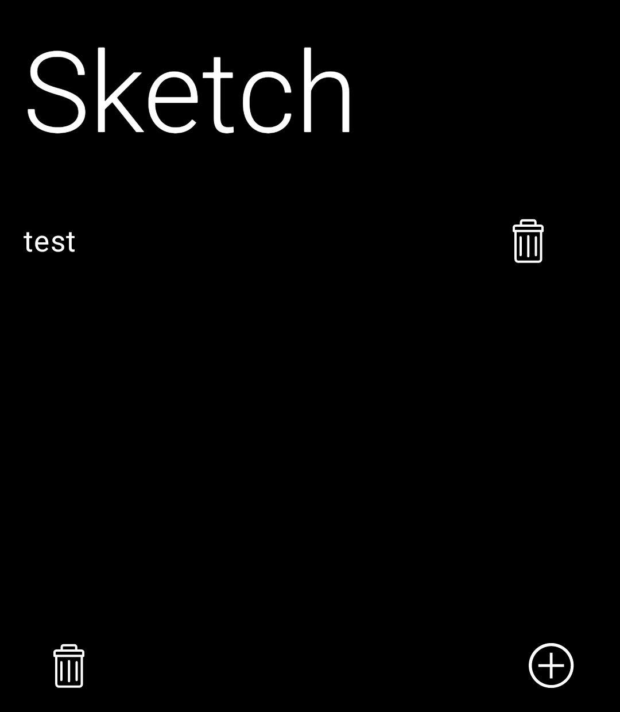
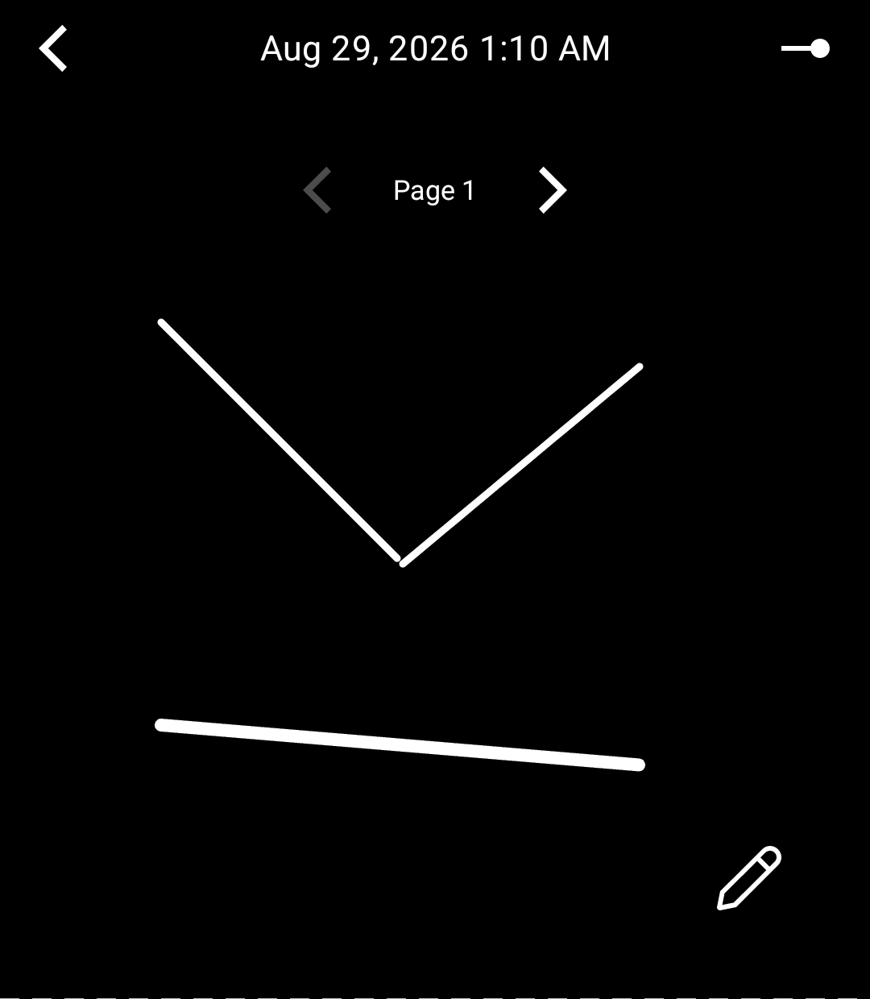
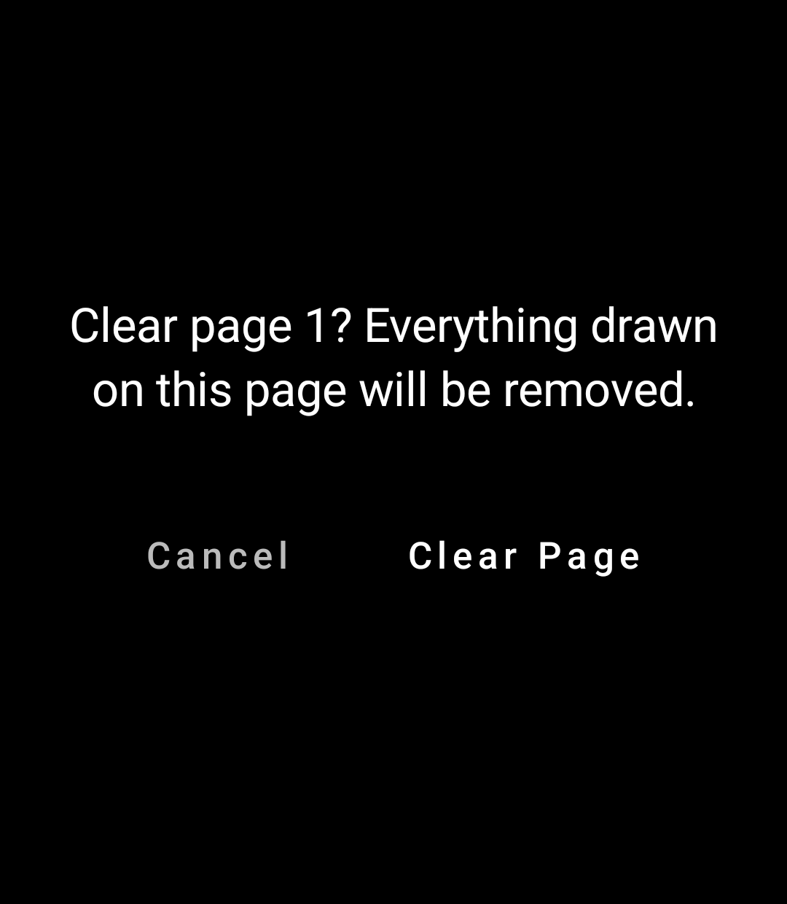
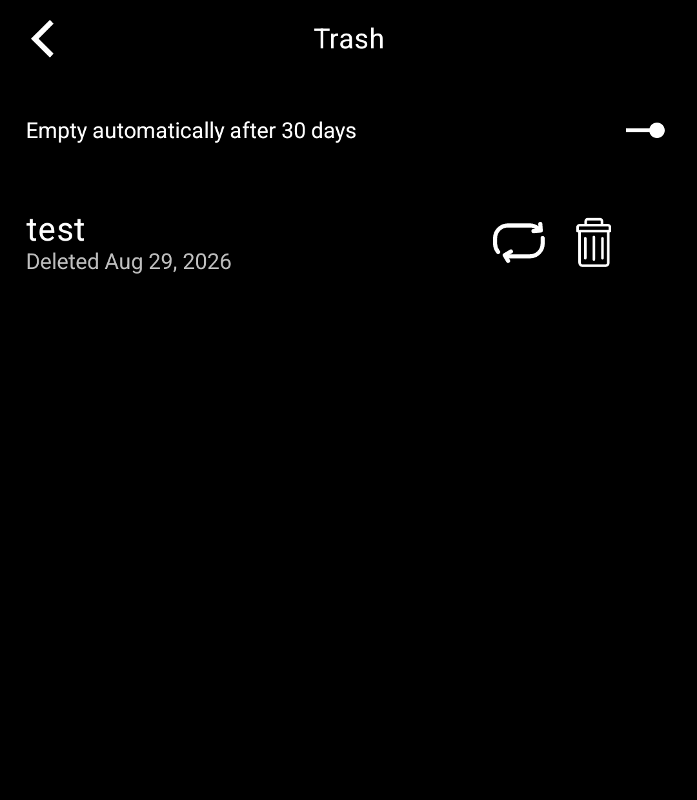

# Light Sketch

A free-form drawing and note-sketching tool for the [Light Phone III](https://www.thelightphone.com/), built with the official [Light SDK](https://github.com/lightphone/light-sdk). Open a blank canvas and draw with a finger or a stylus — pinch to zoom and pan around an effectively infinite page, organize longer sessions into discrete pages when you want them, and everything saves automatically as its own document.

<p align="center">
  
  
  
  
</p>

## What's here

- **An infinite, monochrome canvas** — draw with a finger or stylus (no distinction is made between the two), pinch to pan and zoom. Ink is stored in document space, so it scales naturally with zoom, the way it would if you were really zooming into a page.
- **A document library** — the home screen is a menu of your sketches. Tap `+` to start one, long-press a title (on the home list or inside the canvas) to rename it, tap the trash icon to send one to Trash.
- **A pen tray that stays out of your way** — hidden by default, opened with a small toggle, and it auto-collapses the moment you start drawing, so it never eats into the small screen. Three pen weights, an eraser, and undo.
- **Optional pagination** — a togglable overlay of page guides plus a page-number readout with prev/next, for when you'd rather think in discrete pages than one continuous scroll. Long-press the eraser while paginated to clear just the current page (with a confirmation first).
- **A real Trash** — deleting a sketch soft-deletes it; restore it or delete it forever from the Trash screen, which also has a toggle to auto-empty anything older than 30 days.
- **File-based persistence** — each sketch is its own JSON document under the tool's private storage, with a lightweight index so the home screen never has to parse stroke data just to list names.

Built to the LightOS design system throughout: the 27×31 layout grid, monochrome/grayscale-only palette (no color yet — the display is grayscale OLED anyway), no ripples, and `LightBottomBar`/`LightTopBar` primitives instead of anything that reads as a ported Android app.

## Credit

The idea for this app traces back to Light's ["A Light Afternoon at Index"](https://www.thelightphone.com/blog/a-light-afternoon-at-index) event in June 2025, where attendees were given blank Light Phone III interface worksheets to sketch feature ideas onto. One of those worksheets — drawn by an attendee, not by Light's own team — proposed exactly this: stylus support for freeform drawing and notes, labeled "Go Light." This app is a build of that idea.

## Install the APK

This hasn't been published to a release yet — build it yourself with the instructions below, either for an emulator matching the Light Phone III's spec or for a real device.

## Getting started

```sh
git clone --recurse-submodules https://github.com/rn-os/light-sketch.git
cd light-sketch

# build + install the debug build on a connected device or emulator
./gradlew :tool:installDebug
```

Requirements: Android Studio / SDK with API 34+ available, and either a Light Phone III (in developer mode) or an emulator image matching its spec (1080×1240, API 34, no Google Play Services — see the SDK's own `docs/system_app` for emulator setup).

If you cloned without `--recurse-submodules`, run `git submodule update --init --recursive` before building.

**Targeting a real device vs. the emulator**: `tool/lighttool.toml` has a `serverPackage` field that has to match what you're running against — `com.lightos` for a real Light Phone III, `com.thelightphone.sdk.emulator` for the SDK's own emulator. Swap the commented line before building for the other target.

## Project structure

```
tool/src/main/kotlin/dev/ryanness/lightsketch/
├── HomeScreen.kt   Document library — list, create, rename, trash
├── data/           SketchRepository (JSON persistence), the document/stroke models
└── ui/
    ├── SketchScreen.kt      The canvas screen: top bar, rename, pagination, clear-page
    ├── SketchCanvas.kt      The Compose Canvas + hand-rolled draw/pinch/pan gesture recognizer
    ├── SketchViewState.kt   Pan/zoom state and page-index math
    ├── PenTray.kt           The auto-hiding pen/eraser/undo tray
    ├── PageNavPill.kt       "Page N" readout with prev/next, shown when paginated
    ├── ConfirmDialog.kt     A blocking two-choice confirmation (SDK has no built-in one)
    └── TrashScreen.kt       Restore / delete-forever / auto-empty toggle
```

The trickiest part of the app is the gesture recognizer in `SketchCanvas.kt`: it hand-tracks pointer events (rather than using `detectDragGestures`/`detectTransformGestures`) so that a single finger draws, but a second finger touching down mid-stroke cleanly aborts the in-progress line and hands off to pinch/pan/zoom instead.

## Credits

Scaffolded from [garado/light-sdk-template](https://github.com/garado/light-sdk-template), an opinionated starter for Light SDK tools. The `light-sdk` submodule is [lightphone/light-sdk](https://github.com/lightphone/light-sdk), the official SDK.

## License

MIT — see [LICENSE](LICENSE).
